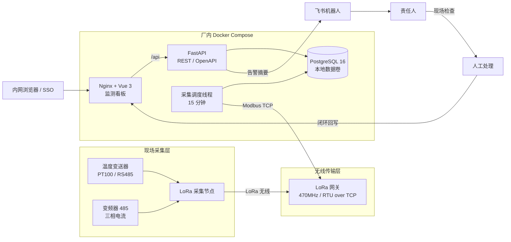
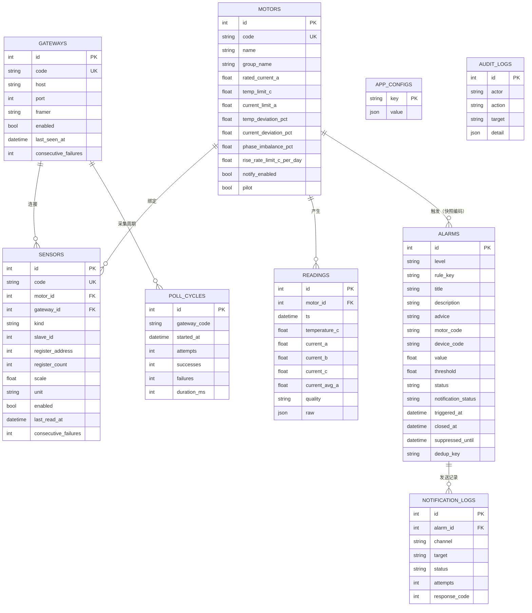

# 整体框架设计

> 版本：v1.0 · 2026-11-12
> 项目：MotorPulse 大电机风险监测平台（试点）

## 1. 目标与边界

### 1.1 目标

1. 每 15 分钟采集电机外壳温度与变频器三相电流，集中监测。
2. 提供领导看得懂的对比分析：自身历史、同类电机、温度 × 电流、趋势。
3. 阈值/基线/温升/通信异常触发飞书通知，处理过程可闭环、可审计。
4. 现场使用 LoRa 减少布线；后台部署在厂内，数据不出厂。
5. 支持从单网关平滑扩展到多网关，点位 ≤ 100。

### 1.2 明确不做

- 不控制电机、不自动停机、不写变频器/传感器寄存器。
- 不做高频振动/频谱分析（LoRa 不适合）。
- 不建设独立账号体系；生产接入公司 SSO。
- 不引入 Kafka/Redis/Kubernetes 等与当前规模不匹配的组件。

## 2. 总体架构



### 2.1 分层职责

| 层 | 组件 | 职责 |
| :--- | :--- | :--- |
| 现场采集 | 温度变送器、变频器、LoRa 节点 | 通过 RS485 汇聚温度/电流，LoRa 上行 |
| 无线传输 | LoRa 网关 | 提供 Modbus TCP 透传（RTU over TCP） |
| 接入层 | Nginx | 静态前端、`/api` 反向代理、安全响应头 |
| 应用层 | FastAPI | 查询 API、告警闭环、设置、OpenAPI |
| 采集层 | Collector 线程 | 15 分钟调度、按网关读取、写读数、触发规则 |
| 数据层 | PostgreSQL | 主数据、读数、告警、通知、采集周期、配置、审计 |
| 通知层 | 飞书 Webhook | 告警卡片、责任人提醒 |
| 展示层 | Vue 3 + ECharts | 总览、对比分析、告警、设备链路、设置 |

## 3. 运行组件

| 容器 | 镜像 | 端口 | 说明 |
| :--- | :--- | :--- | :--- |
| `db` | postgres:16-alpine | 内部 5432 | 数据卷 `pgdata`，`pg_isready` 健康检查 |
| `backend` | python:3.12-slim | 8000 | 启动执行 `alembic upgrade head`，单 worker，含采集线程 |
| `web` | nginx:1.27-alpine | 8080→80 | 托管 `dist`，`/api` 代理到 backend |

后端单 worker 的原因：采集线程必须唯一，避免多副本重复采集；当前 10 用户并发不需要多进程。横向扩容时必须拆分 collector 或仅在一个副本启用。

## 4. 数据模型



### 4.1 关键约束

- `readings` 唯一键 `(motor_id, ts)`：同一 15 分钟桶重复采集只更新，不重复写。
- `sensors` 唯一键 `(motor_id, kind)`：一台电机最多一个温度点、一个三相电流点；后续需要多测点可扩展。
- 告警保存 `motor_code/motor_name` 快照，历史告警不随主数据改名而丢失语义。
- 告警 `dedup_key` 用于去重与闭环后抑制。
- 所有时间以 UTC 入库，前端按 `Asia/Shanghai` 展示。

## 5. 采集链路设计

### 5.1 调度

- 周期：`MP_POLL_INTERVAL_MINUTES=15`。
- 对齐到 15 分钟边界（UTC 分钟数为 15 的倍数），便于聚合与幂等。
- 启动时可选立即采集（`MP_POLL_ON_START=true`）。
- 手动召测：`POST /system/collector/poll` 或设备页按钮；若采集线程正在等待，会立即唤醒；若未启用采集线程，则启动一次性后台采集。
- 周期时间戳使用 `floor_bucket(now, interval)`，手动召测与定时采集在同一桶内会更新同一条读数。

### 5.2 读取

1. 读取启用网关列表与启用传感器，生成按网关分组的内存计划。
2. 每个网关建立一次 `ModbusTcpClient`：
   - `framer=RTU` 对应现场网关的 RTU over TCP 透传；
   - `framer=tcp` 对应标准 Modbus TCP。
3. 按传感器顺序读取保持寄存器：
   - 温度：地址 0，1 个寄存器，int16 有符号，倍率 0.1，单位 ℃。
   - 电流：地址 0–2，3 个寄存器，int16 有符号，倍率 0.01，单位 A。
4. 单点失败重试 `MP_MODBUS_RETRIES` 次（默认 2），每次超时 3 秒；点间间隔 50 ms。
5. 单网关读取完成后关闭连接；多网关按顺序处理，避免超过网关并发连接数。
6. 读取结果按电机聚合为一行读数：
   - 温度/电流都成功：`quality=ok`
   - 部分成功：`quality=partial`
   - 全部失败：`quality=error`（仍写入，用于判断离线，但图表跳过）
7. 写 `poll_cycles` 记录尝试数、成功数、失败数、耗时、错误，用于链路完好率/丢包率。
8. 传感器连续失败 ≥3 次触发“采集传感器通信异常”；网关连续失败 ≥2 次触发“LoRa 网关离线”；恢复后自动闭环。

### 5.3 多网关

- 新增网关：在 `gateways` 增加记录，传感器通过 `gateway_id` 绑定。
- 采集器按网关循环，互不影响；单网关失败不会阻断其他网关。
- LoRa 节点不是独立强模型，当前用电机 `node_code` 表达归属；后续如需节点级 RSSI/电量，可增加 `nodes` 表。

### 5.4 LoRa 参数

- 当前展示：470 MHz、1200 bps、SF7、BW125、CR 4/5。
- “1200”按 **bps** 解释并作为环境变量 `MP_LORA_BAUD_RATE`；实际空口参数由网关/节点配置，后台只记录展示。
- 15 分钟、100 点、每点约 20 B 的数据量对 LoRa 空口非常轻，不构成瓶颈。

## 6. 告警引擎

### 6.1 规则

| rule_key | 级别 | 条件 | 说明 |
| :--- | :--- | :--- | :--- |
| `temp_high` | 严重 | 温度 ≥ 温度上限 | 立即通知，严重告警不受夜间静默限制 |
| `current_high` | 严重 | 三相中任一相电流 ≥ 单相电流上限（无三相时退回平均值） | 过载/单相电气异常 |
| `current_imbalance` | 警告/严重 | 三相不平衡度 ≥ `phase_imbalance_pct`（默认 10%）；≥2 倍阈值升级严重 | 接线/接触器/负载不平衡 |
| `temp_deviation` | 警告 | 温度较 30 天基线中位数偏离 ≥ 阈值（默认 8%） | 自身历史对比 |
| `current_deviation` | 警告 | 电流较基线偏离 ≥ 阈值（默认 10%） | 负载/电气方向 |
| `temp_rise` | 警告 | 近 7 天日平均温升斜率 ≥ 阈值（默认 1.0 ℃/天） | 持续恶化 |
| `sensor_error` | 警告 | 传感器连续 3 个周期读取失败 | 通信/接线/供电 |
| `gateway_offline` | 警告 | 网关连续 2 个周期连接失败 | 网关/网络 |

### 6.2 基线与温升

- 基线窗口：最近 30 天。
- 只使用质量非 `error`、且温度低于当前上限的样本。
- 指标：P10 / P50 / P90；P50 作为偏离基准。
- 另外按本地 2 小时时段计算温度 P10–P90 轮廓，用于自身对比图的“正常带”。
- 温升速率：按本地日期聚合日均温度，对日期序号做最小二乘斜率，至少 3 天样本才判定。
- 基线缓存 60 分钟，减少重复扫描。

### 6.3 生命周期

```text
触发 -> open --人工闭环--> closed（抑制 30 分钟）
  |                         |
  |--同规则更新（不重复）    |--抑制期内不重建
  |
  |--警告/提示连续 2 个周期正常--> 自动 closed
  |--严重告警保持 open，直到人工闭环
```

- **去重**：同一电机 + 同一规则只保留一个活跃告警，后续周期更新数值与时间，不重复通知。
- **抑制**：人工闭环后 30 分钟内不重建同一 `dedup_key`，避免工况未恢复导致告警风暴；可通过 `MP_ALARM_SUPPRESSION_MINUTES` 调整。
- **自动闭环**：警告/提示类连续 2 个采集周期不再命中后自动闭环，闭环人记为 `system`；严重告警必须人工确认。
- **通知**：只有新建告警才发送；通知状态 `pending/sent/failed/skipped` 落库；夜间静默对警告/提示生效，严重告警不受限制。
- **责任人**：温度类默认第一责任人，电流类默认第二责任人，链路类默认最后一位；均可在设置页维护。

### 6.4 飞书

- 输入：环境变量 `MP_FEISHU_WEBHOOK_URL`、可选 `MP_FEISHU_WEBHOOK_SECRET`。
- 卡片字段：对象、级别、触发值、阈值、时间、责任人、异常说明、处理建议。
- 重试：最多 3 次，指数退避；记录 HTTP 状态与响应体。
- 未配置 Webhook 时状态为 `skipped`，不影响告警落库与页面展示。
- 测试：设置页“发送测试消息”调用 `POST /settings/feishu/test`。

## 7. 分析引擎

| 分析 | 接口 | 逻辑 |
| :--- | :--- | :--- |
| 自身历史对比 | `GET /analysis/self` | 30 天 P10–P90 带、P50 基线、温度/电流偏离、规则命中、建议 |
| 同类电机对比 | `GET /analysis/peers` | 同分组的温度、电流、负载率、偏离对比；综合得分 `0.6×温度偏离 + 0.4×电流偏离` 排名 |
| 温度 × 电流四象限 | `GET /analysis/quadrant` | 以自身基线偏离百分比为坐标，定位散热/轴承、负载/电气、双高、正常 |
| 趋势分析 | `GET /analysis/trend` | 24h/7d/30d 趋势、最高/最低/平均温度、温升斜率、区间告警事件 |
| 总览趋势 | `GET /dashboard/trend` | 全部电机均值或指定电机，15m/1h/6h 分桶 |

- 分桶：24h→15 分钟；7d→1 小时；30d→6 小时。
- 聚合：桶内非空温度/电流取平均；电流相取平均。
- 判定：温度偏离 ≥ 8%、电流偏离 ≥ 10% 进入对应象限；阈值与每台电机配置一致。
- 三相：A/B/C 分别取寄存器 0–2；逐相越限和不平衡度独立判定；详情页展示三相数值与不平衡度。
- 不做黑盒模型，规则可解释、可复盘。

### 7.1 日期回看

- 总览、趋势、自身/同类/趋势分析、四象限、电机详情与序列均支持 `date=YYYY-MM-DD`（按 `Asia/Shanghai`）。
- 选择今天：`as_of = 当前时刻`，保持实时行为。
- 选择历史日期：`as_of = 所选日 23:59:59.999`；读数、基线均只使用 `<= as_of` 的数据。
- 历史链路按所选日 `poll_cycles` 统计；告警为当日触发记录；24h 趋势为所选日全天，7d/30d 以所选日为终点。
- 基线缓存按电机 + 小时分桶，避免实时与历史请求互相污染。
- 历史模式只读；设备配置、告警闭环在实时模式操作。

## 8. 前端设计

| 视图 | 路由 | 主要数据 |
| :--- | :--- | :--- |
| 监测总览 | `/overview` | `/dashboard/overview`、`/dashboard/trend`、`/analysis/quadrant`；支持日期回看 |
| 对比分析 | `/analysis` | `/analysis/self`、`/peers`、`/quadrant`、`/trend` |
| 告警中心 | `/alarms` | `/alarms`、`/alarms/{id}`、闭环/批量闭环/导出 |
| 设备与链路 | `/topology` | `/devices`、网关召测 |
| 设备配置 | `/device-config` | 电机/网关/采集点 upsert、删除、召测 |
| 阈值与通知 | `/settings` | `/settings`、`/motors/{code}/thresholds`、飞书测试 |

- 设计系统沿用 `motor-monitor-ui/` 的暗色工业风：电青（电流）、琥珀（温度）、紫（LoRa）、语义色。
- 刷新策略：总览/元信息 60 秒；告警列表 30 秒；趋势/四象限仅在采集周期时间戳变化时刷新；采集本身 15 分钟。
- 性能：侧边栏/顶栏使用实色分层，不使用 `backdrop-filter`；移除无限模糊动画与噪点层；ECharts 开启 `useDirtyRect`。
- 所有页面适配桌面与移动端；移动端侧边栏抽屉化。
- 图表使用 ECharts；KPI 迷你趋势用手绘 SVG，减少图表实例。
- 对比分析四个模式与阈值通知页采用整页填充布局：面板 flex 拉伸，趋势/四象限图表动态占满高度；同类对比补充组内摘要。
- 所有写操作有 toast 反馈；告警闭环、设置保存后刷新相关数据。

## 9. API 设计

- 前缀：`/api/v1`；OpenAPI：`/api/docs`、`/api/openapi.json`。
- 认证：`MP_AUTH_MODE=off`（试点）或 `proxy`（SSO 网关注入 `X-Auth-User`）。
- 错误：HTTP 状态 + `{"detail": "..."}`；422 为参数校验。
- 分页：告警 `page/page_size`；默认 50，最大 200。
- 时间：ISO 8601 UTC（`Z` 结尾），前端本地化；历史查询使用 `date=YYYY-MM-DD`。
- 导出：CSV 带 UTF-8 BOM，防 Excel 乱码；对 `= + - @` 开头字段做 CSV 注入转义。
- 详细契约见 [API 接口文档](API接口文档.md)。

## 10. 部署拓扑

```text
厂区内网
  │
  ├─ 8080 -> web (Nginx + Vue)
  │            └─ /api -> backend:8000
  ├─ 8000 -> backend (FastAPI + collector)
  │            ├─ db:5432 (PostgreSQL volume)
  │            └─ Modbus TCP -> LoRa 网关
  └─ 可选：SSO/oauth2-proxy 置于 web 前，注入 X-Auth-User
```

- 数据卷：`pgdata` 持久化；`config/` 只读挂载。
- 时区：容器 `TZ=Asia/Shanghai`，数据库存 UTC。
- 健康检查：DB `pg_isready`；backend `/api/v1/health`；web `/healthz`。
- 迁移：backend 入口自动 `alembic upgrade head`。
- 备份：`pg_dump` 每日；保留策略与现场 IT 备份策略一致。

## 11. 安全与合规

| 项 | 措施 |
| :--- | :--- |
| 统一身份认证 | 生产 `MP_AUTH_MODE=proxy`，信任 SSO 网关注入的 `X-Auth-User`；不建本地账号 |
| 审计 | 告警闭环、批量闭环、阈值/通知修改写 `audit_logs` |
| SQL 注入 | SQLAlchemy 参数化，无字符串拼接 SQL |
| XSS | Vue 默认转义；`v-html` 仅用于内置静态图标路径，不接收用户输入 |
| CSV 注入 | 导出时对危险前缀加 `'` |
| 密钥 | 飞书 Webhook/DB 密码仅环境变量；`.env` 不入库 |
| CORS | 开发白名单 `localhost:5173`；生产同源 Nginx，无需跨域 |
| 响应头 | `X-Content-Type-Options`、`X-Frame-Options`、`Referrer-Policy` |
| 控制边界 | 采集只读寄存器；无写寄存器/停机接口 |
| 数据出境 | 原始数据只存厂内；飞书仅发送告警摘要 |

## 12. 可靠性与运维

- **通信失败**：单点重试，失败落 `error` 读数与传感器失败计数；连续失败告警；恢复自动闭环。
- **幂等**：读数按 `(motor_id, ts)` 唯一；重复采集更新同一行。
- **告警风暴**：活跃去重 + 30 分钟人工闭环抑制 + 警告自动闭环。
- **可观测**：请求日志含 `X-Request-ID`；`poll_cycles` 记录采集耗时/成功率；健康检查；告警通知日志。
- **数据保留**：默认 180 天，采集线程每日清理读数与旧采集周期。
- **时钟**：依赖 NTP 同步；所有周期以 UTC 对齐。
- **故障恢复**：容器 `restart: unless-stopped`；数据库持久卷；重启后采集器立即按 `MP_POLL_ON_START` 执行。

## 13. 扩展性

| 场景 | 方案 |
| :--- | :--- |
| 多网关 | 增加网关与传感器记录，采集器自动遍历 |
| 多车间/多工厂 | 增加 `group_name` 或引入 `site` 维度，前端分组过滤 |
| 采集独立扩缩容 | 拆分 collector 容器；按网关分片；API 可多副本 |
| 高频/大数据量 | 引入 TimescaleDB 连续聚合/压缩；批量写入 |
| 统一告警平台 | 增加出站 Webhook/消息队列适配器 |
| 工单闭环 | 对接 CMMS，告警闭环同步工单号 |
| 移动端/大屏 | 现有响应式前端可复用，新增只读大屏路由 |

## 14. 关键配置

| 环境变量 | 默认 | 说明 |
| :--- | :--- | :--- |
| `MP_DATABASE_URL` | SQLite（本地） | 生产 `postgresql+psycopg://...` |
| `MP_API_PORT` | 8000 | API 监听与容器健康检查端口 |
| `MP_POLL_INTERVAL_MINUTES` | 15 | 采集周期 |
| `MP_COLLECTOR_MODE` | modbus | `modbus` / `simulator` |
| `MP_RUN_COLLECTOR` | true | 是否启动采集线程 |
| `MP_POLL_ON_START` | true | 启动即采一次 |
| `MP_MODBUS_TIMEOUT_SECONDS` | 3 | 单次读取超时 |
| `MP_MODBUS_RETRIES` | 2 | 单点重试次数 |
| `MP_RETENTION_DAYS` | 180 | 读数保留天数 |
| `MP_BASELINE_DAYS` | 30 | 基线窗口 |
| `MP_ALARM_SUPPRESSION_MINUTES` | 30 | 人工闭环抑制 |
| `MP_FEISHU_ENABLED` | false | 飞书开关 |
| `MP_FEISHU_WEBHOOK_URL` | 空 | 飞书机器人地址 |
| `MP_AUTH_MODE` | off | off / proxy |
| `MP_AUTH_PROXY_HEADER` | X-Auth-User | SSO 用户头 |
| `MP_LORA_FREQUENCY_MHZ` | 470 | 展示用 |
| `MP_LORA_BAUD_RATE` | 1200 | 展示用，按 bps 解释 |

## 15. 代码目录映射

| 目录 | 内容 |
| :--- | :--- |
| `backend/app/api/routes/` | health/dashboard/motors/analysis/alarms/devices/settings/system |
| `backend/app/services/collector.py` | 调度、按网关采集、读数落库、告警触发 |
| `backend/app/services/alarms.py` | 规则、去重、抑制、自动闭环、设备告警 |
| `backend/app/services/analysis.py` | 分桶、斜率、自身/同类/象限/趋势 |
| `backend/app/services/feishu.py` | 卡片、签名、重试、通知日志 |
| `backend/app/db/models.py` | 10 张核心表 |
| `backend/alembic/versions/` | 初始结构 + 告警抑制窗口 |
| `frontend/src/views/` | 6 个业务视图（含设备配置） |
| `frontend/src/components/` | 图表、抽屉、拓扑、状态徽章等 |
| `config/points.example.yaml` | 现场点表示例 |
| `docs/` | 规范、方案、设计、验收、部署、API |

---

关联文档：[技术栈选型](01-技术栈选型.md) · [开发记录](03-开发记录.md) · [验收功能文档](04-验收功能文档.md) · [API 接口文档](API接口文档.md) · [部署手册](05-部署手册.md)
