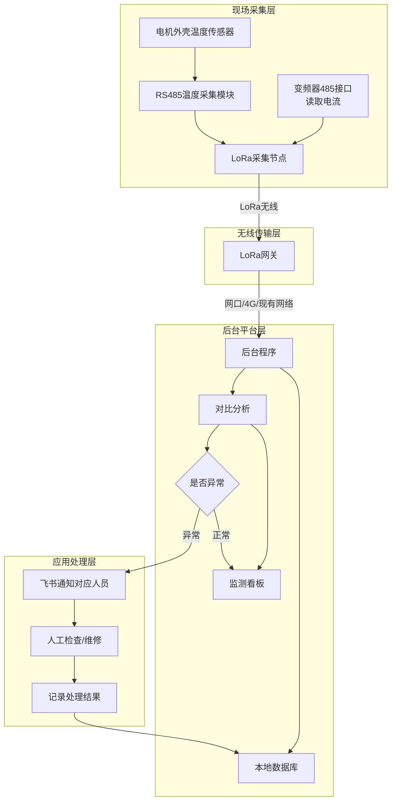

# 大电机温度/电流 LoRa 无线监测与对比分析方案

## 一、项目背景

工厂大电机目前主要靠人工巡检，异常发现不及时，容易造成突然停机。
本项目计划通过采集电机外壳温度和变频器电流，利用 LoRa 无线传输，避免现场网线改造和布线杂乱，在后台做集中监测和对比分析，实现异常早发现、早处理，减少非计划停机。

------

## 二、项目目标

1. 实时查看电机外壳温度和运行电流。
2. 自动比较历史数据、同类电机数据、温度与电流变化关系。
3. 发现异常时，通过飞书及时通知对应人员。
4. 现场采用 LoRa 无线传输，减少网线改造和布线成本。
5. 先试点，投入小、见效快，再考虑推广。
6. 只监测、只报警，不控制电机、不自动停机。

------

## 三、总体方案

整体思路：

- 现场采集：温度传感器、变频器 485 接口。
- 现场汇聚：通过 485 接入 LoRa 采集节点。
- 无线传输：LoRa 节点将数据无线发送到 LoRa 网关。
- 后台读取：后台程序通过网关接口读取数据。
- 数据分析：历史比较、同类比较、温度+电流关联比较。
- 异常通知：飞书通知对应人员

### 整体流程图

------

## 四、数据采集与传输

| 项目       | 方案                                                         |
| :--------- | :----------------------------------------------------------- |
| 温度       | 在电机外壳、轴承端盖表面安装温度传感器，测外壳温度；建议同时参考环境温度 |
| 电流       | 从变频器 485 接口读取，前提是变频器协议开放、能提供电流数据  |
| 现场采集   | 温度、电流通过 485 接入 LoRa 采集节点                        |
| 无线传输   | LoRa 节点将数据无线发送到 LoRa 网关，避免现场新增网线        |
| 网关到后台 | 后台程序通过 LoRa 网关接口读取数据；网关可通过现有网口、厂区网络或 4G 上联 |
| 后台       | 暂不清楚，建议先用现有工控机/服务器；没有再采购小型工控机    |
| 数据       | 本地保存，数据不出厂                                         |

> 注意：LoRa 适合温度、电流有效值等低频、小数据量传输。若后续要做高频振动分析，LoRa 不适合，需要另行考虑有线或高速无线方案。

------

## 五、数据分析比较（核心）

不搞复杂算法，重点做领导看得懂的对比：

1. **自己和自己比**：同一台电机现在和过去正常状态比，看温度、电流是否偏高。
2. **同类电机比**：同功率、同工况电机之间比，看哪台明显异常。
3. **温度 + 电流一起看**：
   - 电流正常但温度持续升高，可能是散热、轴承或润滑问题；
   - 温度正常但电流异常，可能是负载或电气问题。
4. **趋势比较**：看一天、一周、一月的走势，是偶发还是持续恶化。
5. **阈值报警**：设定上限，超过就提醒。

------

## 六、需要领导支持

1. 确定试点电机范围，建议先选 1—3 台关键电机，跟惠哥进行沟通，判断实际要监控电机的规格和数量。
2. 指定飞书通知群和异常响应责任人。
3. 明确试点周期和验收标准。